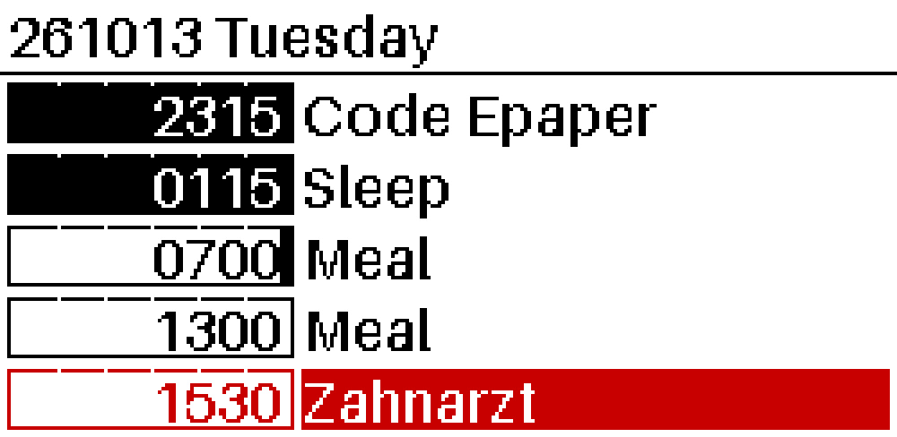

# StDev-Epap2.13
Show `.ical` events on an Epaper module produced by WeAct Studio with special adaptation to the `.ical` format used for [Stedule](https://github.com/stetai/stedule.git).

Implements a progress bar counting down to the next events and highlighting of events in the category "Important".

Example Output:

Forked and detached from [WeAct Studio Epaper Module](https://github.com/WeActStudio/WeActStudio.EpaperModule.git).
